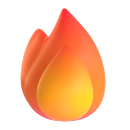
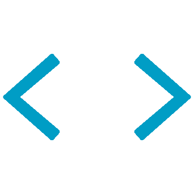
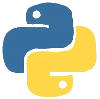
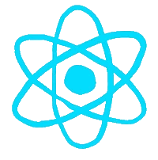
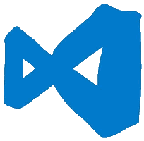
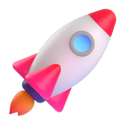
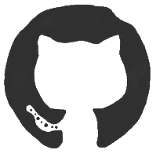
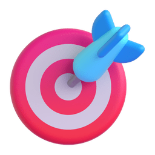

 

&nbsp;&nbsp;

 

##  About me

-  My fixes are merged into **React Hook Form**, **MobX**, **Slate** and the **Bluesky** app
-  I build **AI tooling on the Model Context Protocol**: my After Effects server gives AI clients **57 tools**
-  I built a **hosting management platform** from scratch to replace WHMCS: customer portal, PayPal billing, provisioning and an Arabic control panel, with 485 test files and 15 CI workflows
-  **Full-stack**: TypeScript, Node.js, React and Next.js on Linux, plus Python, C++ and Lua
-  **Arabic / RTL / i18n**: I make software work correctly in both directions
-  Based in Jeddah, Saudi Arabia

 

##  Featured project

### <a href="https://github.com/a-y-ibrahim/after-effects-mcp">after-effects-mcp</a>

**An MCP server for controlling Adobe After Effects from AI clients.**

ExtendScript execution, background rendering, deep project and layer inspection,
and first-class Arabic / RTL and multilingual support, all in **57 tools**.
Built on earlier community work, credited in the repo.

 

##  Open-source contributions

**Merged fixes in projects with a combined 120K+ stars.** I ship small, reviewable pull requests upstream.

&nbsp;

 

| Project | Stars | What I shipped | Status |
| :-- | :--: | :-- | :--: |
| **[react-hook-form/react-hook-form](https://github.com/react-hook-form/react-hook-form/pull/13599)** |  | Fixed a race condition in which stale `_setValid()` calls overwrote `isValid` and `isValidating` | <!--status:react-hook-form/react-hook-form#13599--><!--/status--> |
| **[mobxjs/mobx](https://github.com/mobxjs/mobx/pull/4684)** |  | Fixed a stack overflow in `endBatch()` when a Reaction is disposed from `onBecomeUnobserved` | <!--status:mobxjs/mobx#4684--><!--/status--> |
| **[ianstormtaylor/slate](https://github.com/ianstormtaylor/slate/pull/6084)** |  | Kept the DOM in sync in slate-react when a native `insertText` is a no-op | <!--status:ianstormtaylor/slate#6084--><!--/status--> |
| **[bluesky-social/social-app](https://github.com/bluesky-social/social-app/pull/11066)** |  | Stopped invisible bidi characters from leaking into copied handles across the web app | <!--status:bluesky-social/social-app#11066--><!--/status--> |

##  Tech I build with

Also Express, NestJS, Fastify, Prisma, PostgreSQL, Redis, Docker, Nginx, Cloudflare and Flutter

 

<b>More about how I work</b> (click to expand)

 

-  I care about **accessibility and internationalization**, especially getting RTL right, because half-broken Arabic UIs are everywhere and I enjoy fixing them.
-  I like connecting **AI clients to real creative tools** (that is where After Effects + MCP came from).

##  Watch the snake eat my contributions

<picture>
<source media="(prefers-color-scheme: dark)" srcset="https://raw.githubusercontent.com/a-y-ibrahim/a-y-ibrahim/output/github-snake-dark.svg" />
<source media="(prefers-color-scheme: light)" srcset="https://raw.githubusercontent.com/a-y-ibrahim/a-y-ibrahim/output/github-snake.svg" />

</picture>

 

<b>~</b> <a href="https://a-y-ibrahim.com/">a-y-ibrahim.com</a>

